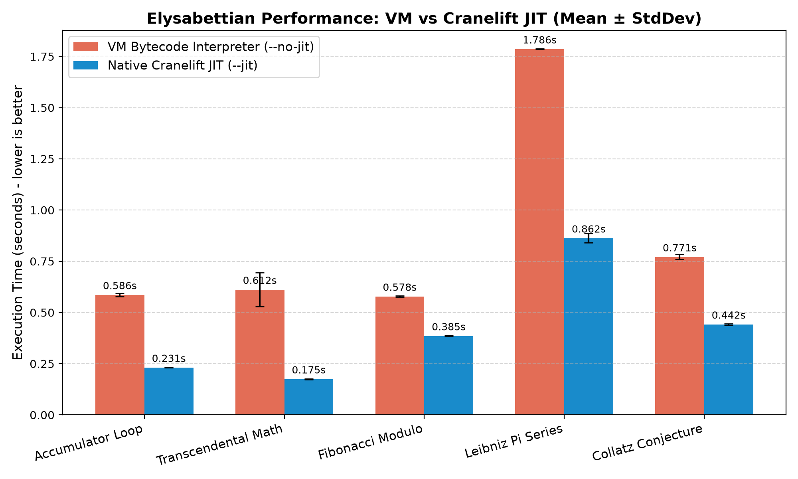
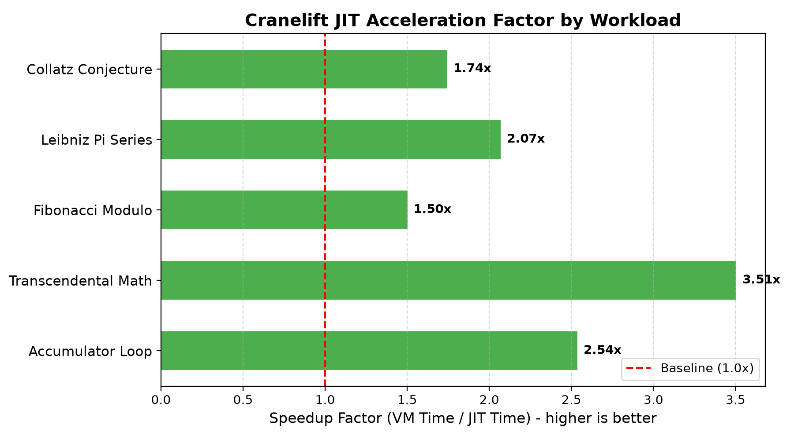

# Elysabettian Scientific Benchmark Report

Evaluation of runtime performance comparing Bytecode Virtual Machine (`--no-jit`) with Cranelift Native JIT (`--jit`).

### Methodology
- **Hardware Platform:** Host CPU execution via Cranelift Native ISA.
- **Execution Rounds:** 2 warmup iterations followed by 5 timed evaluation runs per workload.
- **Statistical Metrics:** Sample Mean ($\mu$), Sample Standard Deviation ($\sigma$), and Speedup Factor ($\mu_{VM} / \mu_{JIT}$).
- **Verification:** Bit-exact string comparison of output values between VM and JIT executions.

### Benchmark Results Summary

| Workload | Description | VM Mean (s) | JIT Mean (s) | Speedup | Result Parity |
| :--- | :--- | :---: | :---: | :---: | :---: |
| **Accumulator Loop** | Simple numeric counter & accumulator (2,000,000 iters) | 0.5859s ± 0.0079 | 0.2309s ± 0.0007 | **2.54x** | Verified |
| **Transcendental Math** | Floating-point multiply/divide with Pi & e (2,000,000 iters) | 0.6117s ± 0.0821 | 0.1745s ± 0.0020 | **3.51x** | Verified |
| **Fibonacci Modulo** | Iterative Fibonacci sequence with register shifts (1,000,000 iters) | 0.5781s ± 0.0029 | 0.3851s ± 0.0026 | **1.50x** | Verified |
| **Leibniz Pi Series** | Alternating infinite series approximation of Pi (5,000,000 iters) | 1.7856s ± 0.0021 | 0.8623s ± 0.0222 | **2.07x** | Verified |
| **Collatz Conjecture** | 3n + 1 trajectory steps using bitwise shifts (25,000 ranges) | 0.7706s ± 0.0126 | 0.4418s ± 0.0038 | **1.74x** | Verified |

### Visual Performance Charts

